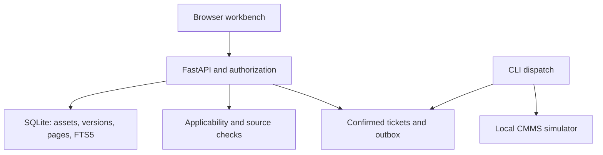

# MAINTAIN

**Evidence-first maintenance research. Applicable sources before action.**

[](https://github.com/oussamawalker1997-hub/maintain-copilot/actions/workflows/ci.yml)

MAINTAIN is a local engineering demonstrator for finding technical documentation for the correct asset, hardware revision and firmware. It combines a Python API, a browser workbench, versioned documents, source references, access controls and a confirmed ticket workflow.

**Status: v0.1 — working B0 lexical baseline.** This release does not use an LLM, embeddings or autonomous agents. The engineering mission describes the broader target; this repository does not claim that target is already delivered. Company, machines and documentation in the fixtures are fictional. No industrial outcomes or business savings are claimed.

## What works

- Local browser workbench, in French, with memory-only bearer credentials.
- Site-scoped asset selection and lexical FTS5 search with page references.
- Hardware and numeric firmware applicability, unknown-code abstention and incomplete-variant clarification.
- Reviewed draft publication, exact-range supersession, revocation and conservative revision-conflict abstention.
- Text-page ingestion; trusted local PDF extraction and unreadable-file quarantine through the API.
- User-confirmed tickets, transactional outbox, concurrent idempotent retries and a **local CMMS simulator**.
- Source revalidation for saved runs, tickets and dispatch, structured audit events, bounded requests and rate limits.
- Repeatable synthetic fixtures, automated tests, a public smoke evaluation and database backup command.

## Quick start — Windows PowerShell

Install Python 3.12 or newer. Extract the project, then open PowerShell in the directory containing `pyproject.toml`. No global Python changes and no PowerShell activation-policy changes are required.

```powershell
py -3.12 -m venv .venv
.\.venv\Scripts\python.exe -m pip install -r requirements.lock
.\.venv\Scripts\python.exe -m pip install --no-deps -e .
.\.venv\Scripts\python.exe -m maintain.cli seed
.\.venv\Scripts\python.exe -m maintain.cli serve
```

Open **http://127.0.0.1:8000**. In a second PowerShell window:

```powershell
Get-Content .local\demo-credentials.json
```

Copy the value of `tech-a` into the login field. These are randomly generated **local demonstration keys**, not GitHub tokens. Do not send them to anyone. The file is ignored by Git. Select `NW-P17`, then search `E042`. This corpus cites page 2; the mission's page-12 example is illustrative.

If the Python launcher is unavailable, replace `py -3.12` with the full path to your Python 3.12 interpreter. The initial `seed` command refuses to overwrite an initialized database. To start a separate demo without losing the first, use `--database .local/second/maintain.sqlite` before each subcommand.

## Quick start — Linux/macOS

```bash
python3 -m venv .venv
.venv/bin/python -m pip install -r requirements.lock
.venv/bin/python -m pip install --no-deps -e .
.venv/bin/python -m maintain.cli seed
.venv/bin/python -m maintain.cli serve
```

Read `.local/demo-credentials.json` locally. Sign in as `tech-a` (site A), `editor-a` (site A, document lifecycle permissions), or `tech-b` (site B). Keys are stored as SHA-256 hashes in the database; the plaintext local onboarding file is private and never part of a release archive. For enterprise deployment, replace this demonstration authentication with OIDC and managed authorization.

## Try the end-to-end workflow

1. `NW-P17` + `E042`: applicable rev-B evidence; open the page reference.
2. `NW-P18` + `E042`: older hardware receives different source evidence.
3. `NW-P19` + `E042`: firmware missing; clarification rather than a guess.
4. `NW-P17` + `E099`: unknown code; abstention, even if common words match.
5. Confirm a ticket with factual observations. It remains `pending` until dispatch.
6. Run the local delivery simulator in another terminal:

```powershell
.\.venv\Scripts\python.exe -m maintain.cli dispatch
```

The local documentation page at `/docs` links to `/openapi.json`. Import that schema into your API client. JSON endpoints require `Authorization: Bearer <local-key>`; see `docs/API.md` for request examples. No external scripts are loaded by the workbench or API documentation.

## Validation

```powershell
.\.venv\Scripts\python.exe -m pytest -q
.\.venv\Scripts\python.exe -m ruff check .
.\.venv\Scripts\python.exe -m ruff format --check .
.\.venv\Scripts\python.exe scripts\evaluate.py
.\.venv\Scripts\python.exe scripts\verify_live.py
```

Linux/macOS: replace the executable prefix with `.venv/bin/python` and use `scripts/evaluate.py`.

`scripts/evaluate.py` creates an isolated temporary database, executes the ten public smoke cases and writes `artifacts/evaluation.json`. It does not use your local demo data. The public smoke set is small, known during development and **not an independent quality benchmark**. It cannot validate production safety, semantic correctness or business value. Read [verification evidence](docs/verification.md).

## Architecture



All source content and fixtures are local; there are no model API calls. SQLite is a deliberate **local baseline decision**, not the PostgreSQL/RLS production architecture in the mission. Authorization is application-level. Database access grants access to all sites. FTS index statistics are global, so this design does not claim statistical side-channel isolation. See [ADR-001](docs/adr/001-local-baseline.md).

## Project map

| Location | Purpose |
|---|---|
| `src/maintain/app.py` | API, authentication, request limits, safe errors and UI delivery |
| `src/maintain/retrieval.py` | B0 search, numeric applicability, source revalidation |
| `src/maintain/documents.py` | Document ingestion and quarantine |
| `src/maintain/tickets.py` | Confirmation, idempotence, outbox and local simulator |
| `src/maintain/schema.sql` | Database schema v1 |
| `src/maintain/web/` | Dependency-free browser workbench |
| `fixtures/synthetic/` | Original fictional source documents and asset metadata |
| `tests/` | Access, lifecycle, concurrency, request and restore tests |
| `evaluations/` | Public smoke cases |
| `docs/mission.fr.md` | Full target mission in French |
| `docs/roadmap.fr.md` | Implementation status and remaining delivery gates |

## Before any enterprise pilot

This version binds to `127.0.0.1` and is intended for a single trusted machine. Do not expose it publicly. PDF parsing is synchronous and **not sandboxed**: import only trusted test files. Request-size limits do not protect against all malicious or compressed PDF inputs. There is no OCR, enterprise SSO, PostgreSQL RLS, independent final evaluation, LLM synthesis, hybrid retrieval, remote CMMS integration, managed secrets, retention enforcement, or validated industrial procedure.

The local simulator's atomicity does not imply exactly-once delivery to a remote service. Restore does not yet replay deletion/revocation tombstones; see the runbook. API rate limits are per process and are not distributed. No 30-day SLO or large-corpus load target has been demonstrated.

## Optional Docker setup

### PostgreSQL foundation

The separate [PostgreSQL setup guide](docs/postgres.fr.md) prepares local secrets, starts PostgreSQL 17, applies checksummed SQL migrations and verifies isolation with actual site-specific database logins. The PostgreSQL CI job runs these checks on a real server. **This foundation does not yet switch the API from SQLite or migrate existing data.**

### Existing SQLite application container

Docker is not required for the Windows quick start. Container files are provided but have not been executed in the authoring environment. With Docker installed:

```bash
docker compose build
docker compose run --rm app python -m maintain.cli seed
docker compose up -d
docker compose exec app cat /data/demo-credentials.json
```

Use `docker compose exec app python -m maintain.cli dispatch` for the simulator. The named volume retains data and credentials. The published port is bound to localhost only. The image currently includes test dependencies from the full lockfile; split runtime/dev locks before optimizing an enterprise image.

## GitHub

Repository: [oussamawalker1997-hub/maintain-copilot](https://github.com/oussamawalker1997-hub/maintain-copilot).

```bash
git clone https://github.com/oussamawalker1997-hub/maintain-copilot.git
cd maintain-copilot
```

Follow the Windows or Linux setup above from this directory. If you already initialized a ZIP-based installation, keep it until you have transferred and backed up its local data; cloning does not transfer `.local/` or your virtual environment. Never re-run seed over an existing database.

GitHub Actions checks Linux and Windows: lint, formatting, tests, the public smoke evaluation and a real loopback HTTP workflow. Actions are pinned to verified commit SHAs. The badge reports the actual workflow status; the existence of a workflow file alone is not evidence of a passing remote run.

Do not commit `.local/`, `.env`, credentials, databases, backups or company PDFs. The repository contains original synthetic material only. It remains a demonstrator until the separate pilot requirements are met.

## References

- [FastAPI lifespan](https://fastapi.tiangolo.com/advanced/events/).
- [SQLite FTS5 and BM25](https://www.sqlite.org/fts5.html).
- [Broader evaluation rationale](https://www.anthropic.com/research/demystifying-evals-for-ai-agents).

MIT license for the code. Synthetic fixture documents are original and included under the same license. Neither the project nor its fictional documents are instructions for operating real machinery.
