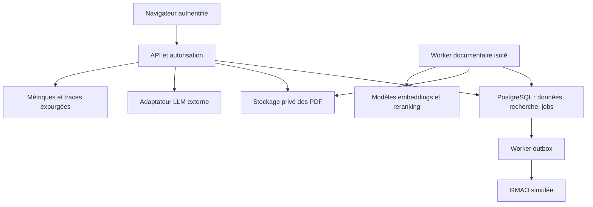

# MAINTAIN — Dossier de mission AI Engineering

Version 1.0 — 26 octobre 2026 — Document de cadrage et de réalisation individuelle.

**Scénario fictif réaliste.** NordWerk Packaging est une entreprise inventée. Les personnes, incidents, volumes et gains ci-dessous ne décrivent aucune entreprise réelle. Aucun résultat de production n’est revendiqué. Les exemples de machines NW et leurs documents sont synthétiques ; ne pas les utiliser pour une intervention réelle.

Statuts : **H** = hypothèse à vérifier ; **O** = objectif proposé ; **D** = décision de conception ; **M** = résultat à mesurer. Les seuils sont des critères de projet proposés, pas des performances déjà obtenues.

## 1. Brief de mission

« Vous prenez en charge MAINTAIN, notre assistant de recherche technique pour la maintenance. Votre première responsabilité est de vérifier qu’il permet de retrouver une information correcte plus rapidement que notre recherche actuelle. Vous livrerez ensuite une tranche utilisable, évaluée et exploitable. »

**H — Entreprise cible :** fabricant d’emballages, deux sites allemands, 80 équipements, 24 techniciens sur plusieurs équipes. La documentation mêle PDF constructeur, procédures internes et comptes rendus. Une seule famille d’équipements et un site entrent dans le premier pilote.

**Déclencheur fictif :** trois incidents récents ont révélé l’utilisation d’anciennes versions de procédures. Les techniciens ont correctement escaladé les cas, mais la recherche documentaire a prolongé leur traitement. Aucun montant de perte n’est établi.

**Problème :** les codes d’alarme sont recherchés dans plusieurs répertoires ; le nom commercial ne suffit pas à identifier la variante matérielle. Les réponses transmises oralement sont difficiles à vérifier.

**Sponsor métier :** responsable maintenance. **Responsable technique :** responsable applications industrielles. **Utilisateurs :** techniciens, référents techniques, responsables documentaires. **Parties prenantes :** sécurité des systèmes, responsable sécurité industrielle, protection des données, exploitation et représentants du personnel si applicable.

**O — Résultat :** retrouver les passages applicables, afficher leurs limites de validité et préparer un dossier de ticket. La décision d’intervention reste humaine.

**Responsabilités de l’ingénieur :** découverte utilisateur, inventaire des données, baseline, pipeline documentaire, API, interface, évaluations, sécurité, déploiement, documentation et runbooks. Il expose les incertitudes et demande les arbitrages aux propriétaires concernés.

**Arbitrages externes :** autorisation d’utiliser les documents ; transfert éventuel au fournisseur de modèle ; conservation ; validation des procédures ; confirmation du périmètre de sécurité ; autorisation du pilote. Le développeur ne s’attribue pas la validation juridique ou industrielle.

## 2. Processus actuel et cible

**Journée représentative, hypothèse :** à 08 h 15, une technicienne constate une alarme. Elle identifie l’équipement dans la GMAO, ouvre le partage documentaire, essaie le code puis ses variantes, vérifie le modèle et la révision, contacte un référent, et consigne ses observations. Le blocage principal est l’applicabilité des documents, pas seulement leur présence.

| Étape | Aujourd’hui, hypothèse | Processus cible | Responsabilité humaine |
|---|---|---|---|
| Identification | Plaque et fiche parfois différentes | Sélection de l’actif, confirmation de la variante | Confirmer l’identité matérielle |
| Recherche | Explorateur, PDF, échanges | Recherche filtrée par actif, site et version | Compléter le contexte |
| Lecture | Comparaison manuelle de pages | Synthèse avec pages et avertissements | Vérifier les passages sources |
| Incertitude | Appel informel | Demande de précision ou abstention explicite | Arbitrer et escalader |
| Traçabilité | Texte libre dans la GMAO | Brouillon reprenant faits et références | Relire et approuver le ticket |

**Exemple de bout en bout — intégralement synthétique.** Entrée : actif `NW-P17`, modèle `NW-Conveyor-C2`, contrôleur `rev-B`, firmware `2.4`, site `DE-A`, question « Que signifie E042 et quelles informations relever ? ». Document de test `NW-C2-MAN`, révision 3, page 12 : « E042 : retour du capteur d’entrée absent. Relever l’état de l’indicateur et l’horodatage ; transmettre au référent si la cause n’est pas identifiée. »

Sortie attendue : « Le manuel applicable décrit une absence de retour du capteur d’entrée [1]. Informations à consigner : état de l’indicateur et horodatage [1]. La cause matérielle n’est pas établie. » Citation [1] vers la page 12, révision 3. Aucune consigne électrique inventée, aucun redémarrage proposé. Un brouillon de ticket conserve cette séparation entre observation et hypothèse.

## 3. Valeur et critères de succès

| Type | Problème / indicateur | Initial H | Cible O | Mesure et période | Limite |
|---|---|---|---|---|---|
| Métier | Temps jusqu’à une source correcte | Médiane 12 min | ≤ 8 min | Exercices comparatifs sur 2 semaines | Base à mesurer, effet d’apprentissage |
| Métier | Utilité pour le travail | Inconnue | ≥ 80 % de tâches jugées utiles | 6 utilisateurs, 10 tâches chacun | Petit panel, pas de preuve de gain financier |
| Métier | Temps de préparation du ticket | 6 min | ≤ 4 min | Chronométrage de 20 tickets de test | Tickets simulés |
| IA | Recherche, Recall@5 | Baseline à mesurer | ≥ 90 % des 100 questions répondables finales | Annotation des passages pertinents | Pertinence parfois multiple |
| IA | Réponses entièrement soutenues | À mesurer | ≥ 90 % des réponses factuelles émises | Revue humaine, test final | Rapporter aussi la couverture |
| IA | Cas non répondables | À mesurer | ≥ 90 % d’abstentions correctes sur 50 cas | Documents absents ou contradictoires | Généralisation limitée |
| IA | Cas critiques | Inconnue | 0 fuite ou recommandation dangereuse observée sur la suite critique | 50 tests distincts | Zéro observé ne prouve pas zéro risque |
| Opérations | Latence de réponse complète | Non applicable | p95 ≤ 10 s | Test de 1 h, charge définie en §13 | Dépend du fournisseur |
| Opérations | Disponibilité API | Non applicable | 99 % au pilote sur 30 jours | Sondes / erreurs | SLO non démontrable sur une courte démo |
| Coût | Coût variable par réponse | Inconnu | ≤ 0,05 € en hypothèse budgétaire | Tokens et facturation rapprochés chaque semaine | Plafond proposé, tarif à vérifier |

**Attribution :** comparer A = recherche classique et B = copilot avec corpus et permissions identiques. Répartir des tâches de difficulté proche, contrebalancer l’ordre, sans faire résoudre deux fois la même tâche au même participant. Évaluateur des réponses aveugle à la condition lorsque possible. Rapporter médianes, dispersion, exactitude et abandons. Les 60 tâches sont un signal exploratoire, pas une étude définitive. Un test distant sur documents ne mesure pas un temps réel de réparation.

**Arrêt ou retour en conception :** fuite d’accès ; réponse dangereuse ; droits documentaires non résolus ; manque de documents applicables ; absence d’amélioration utile après deux itérations limitées ; budget dépassé sans hypothèse crédible de réduction. Ne pas acheter davantage de complexité pour masquer une absence de valeur.

## 4. Périmètre et exigences

**Initial :** un site, une famille de machines, texte allemand/anglais, PDF lisibles, citations, recherche, abstention, retour utilisateur, GMAO simulée. **Exclus :** action sur automate, diagnostic certifié, reconnaissance de photos, analyse exhaustive de schémas, streaming de capteurs, maintenance prédictive, multi-agent, Kubernetes et fine-tuning. **Dépendances :** corpus autorisé, métadonnées fiables, modèle accessible, annotation et avis métier. **Évolutions :** OCR puis schémas si les tests prouvent le besoin ; connecteur GMAO réel après pilote.

P0 = condition de livraison ; P1 = nécessaire au pilote. Les critères de sécurité s’appliquent même au démonstrateur.

| ID | Priorité | Exigence et justification | Acceptation |
|---|---|---|---|
| FR-001 | P0 | Identifier actif/variante pour éviter une mauvaise procédure | Modèle inconnu ou version absente : clarification avant synthèse |
| FR-002 | P0 | Importer et versionner les sources | Même hash importé deux fois : une seule version ; PDF illisible en quarantaine |
| FR-003 | P0 | Rechercher dans le corpus autorisé | Recall@5 et tests de permissions du §11 réussis |
| FR-004 | P0 | Réponse sourcée et bornée | Chaque affirmation factuelle renvoie à une page ; seuil de soutien du §3 |
| FR-005 | P0 | S’abstenir en cas d’absence/conflit | Suite des 50 cas non répondables réussie au seuil du §3 |
| FR-006 | P0 | Préparer puis confirmer un ticket | Aucun envoi sans confirmation ; même clé : un seul ticket |
| FR-007 | P0 | Révoquer ou remplacer une source | Source révoquée invisible dès la requête suivante ; contexte en vol revalidé |
| FR-008 | P1 | Recueillir un feedback contextualisé | Feedback lié au run et à la version, sans modification du jeu final |
| NFR-001 | P0 | Isolation et permissions | 0 contenu ou métadonnée d’un périmètre interdit sur la suite critique |
| NFR-002 | P0 | Latence et charge | p95 ≤ 10 s, 6 générations concurrentes, 6 requêtes/min pendant 1 h |
| NFR-003 | P1 | Disponibilité | Sondes disponibles ≥ 99 % sur 30 jours, maintenance incluse |
| NFR-004 | P0 | Coût maîtrisé | Limites de tokens, concurrence, quota journalier et arrêt du fournisseur vérifiés |
| NFR-005 | P0 | Confidentialité | Pas de texte métier ou secret dans les logs standards ; test par données sentinelles |
| NFR-006 | P0 | Reproductibilité | Instance vierge opérationnelle via README et données synthétiques |
| NFR-007 | P1 | Accessibilité | Parcours principal au clavier, focus visible, labels et contraste vérifiés manuellement |
| NFR-008 | P1 | Reprise | RPO ≤ 24 h, RTO ≤ 4 h vérifiés par restauration chronométrée |
| NFR-009 | P0 | Fraîcheur | Publication valide visible en ≤ 15 min pour le corpus de référence, révocation immédiate |
| NFR-010 | P0 | Bornes | PDF ≤ 20 Mo / 500 pages ; question ≤ 4 000 caractères ; rejet explicite au-delà |

## 5. Cas d’utilisation détaillés

### UC-01 — Rechercher une information applicable

**Acteur / objectif :** technicien, trouver une référence correcte. **Déclencheur :** soumission d’une question. **Préconditions :** session valide, actif accessible et identifié. **Entrées :** actif, question, langue.

**Nominal :** 1. vérifier identité et droits ; 2. charger la configuration de l’actif ; 3. filtrer les documents applicables ; 4. effectuer recherche et reranking ; 5. produire une réponse structurée ; 6. vérifier citations et droits ; 7. afficher passages et versions.

**Alternatives :** code exact : favoriser la recherche lexicale ; donnée de variante manquante : demander une précision. **Exceptions :** fournisseur indisponible → UC-04 ; droits expirés → UC-06. **Postcondition :** run persisté, aucune action physique. **Audit :** acteur pseudonymisé, scope, versions, statut et trace. **Acceptation :** fixture E042 conforme au §2 et critères FR-003/004.

### UC-02 — Publier une révision documentaire

**Acteur / objectif :** documentaliste, rendre une source fiable disponible. **Déclencheur :** dépôt d’une nouvelle révision. **Préconditions :** rôle éditeur dans le site ; déclaration de droits. **Entrées :** PDF, modèle, plage de versions, langue et statut.

**Nominal :** 1. valider taille/type et hash ; 2. créer job ; 3. extraire pages ; 4. contrôler qualité ; 5. générer chunks et index en staging ; 6. demander la publication explicite par le responsable documentaire ; 7. basculer la version active en transaction.

**Alternatives :** hash déjà connu → renvoyer l’existant ; ancien manuel conservé pour un équipement ancien explicitement associé. **Exceptions qualité :** PDF image sans texte → quarantaine, raison visible ; pages manquantes → refus de publication. **Postcondition :** version active cohérente, aucune version partielle. **Audit :** hash, validateur, date, index. **Acceptation :** FR-002/007 et NFR-009 ; ancienne version non citée pour la mauvaise variante.

### UC-03 — Transformer une réponse en ticket

**Acteur / objectif :** technicien, documenter le problème. **Déclencheur :** « Préparer un ticket ». **Préconditions :** run accessible, droit de création, actif confirmé. **Entrées :** run, observations, confirmation et clé d’idempotence.

**Nominal :** 1. produire un brouillon ; 2. séparer faits et hypothèses ; 3. afficher références ; 4. faire confirmer par l’utilisateur ; 5. enregistrer ticket et événement outbox en transaction ; 6. envoyer au connecteur ; 7. afficher identifiant ou état pending.

**Alternatives :** utilisateur modifie ou abandonne. **Exceptions :** timeout externe → reconciliation avant réessai ; même clé avec autre corps → 409. **Postcondition :** au plus un effet métier pour la clé, ou état inconnu explicite. **Audit :** confirmation, payload hash, tentatives et référence externe. **Acceptation :** dix répétitions et un timeout n’engendrent qu’un ticket avec le simulateur ; aucun succès annoncé sans confirmation externe.

### UC-04 — Continuer en mode dégradé

**Acteur / objectif :** technicien, accéder aux sources malgré une panne LLM. **Déclencheur :** timeout/circuit ouvert. **Préconditions :** base et authentification disponibles. **Entrées :** recherche UC-01.

**Nominal :** 1. interrompre la génération au délai ; 2. rechercher lexicalement dans le scope autorisé ; 3. afficher extraits, pages et message de dégradation ; 4. permettre la préparation manuelle d’un ticket.

**Alternatives :** service vectoriel défaillant mais SQL disponible → lexical seul. **Exceptions :** base ou moteur d’autorisation indisponible → 503, aucune source servie. **Postcondition :** pas de fausse synthèse. **Audit :** cause et mode. **Acceptation :** injection de panne ; fallback p95 ≤ 2 s sous la même charge, hors indisponibilité SQL.

### UC-05 — Traiter une contradiction

**Acteur / objectif :** technicien et référent, éviter un choix arbitraire. **Déclencheur :** documents applicables incompatibles. **Préconditions :** accès aux deux sources. **Entrées :** question et versions.

**Nominal :** 1. détecter conflit de métadonnées ou prescriptions ; 2. suspendre la synthèse prescriptive ; 3. afficher les deux références et leurs statuts ; 4. demander une revue ; 5. le référent corrige les métadonnées ou publie une décision documentaire.

**Alternatives :** conflit résolu par une plage firmware explicite → filtrer et expliquer l’applicabilité. **Exceptions :** contradiction textuelle non détectée automatiquement → limite déclarée et revue utilisateur. **Postcondition :** aucun arbitrage silencieux du modèle. **Audit :** conflit, sources, résolution. **Acceptation :** suite de conflits annotés ; tous les conflits critiques connus entraînent abstention.

### UC-06 — Refuser un accès non autorisé

**Acteur :** utilisateur du site A tentant de lire B. **Objectif système :** confidentialité. **Déclencheur :** URL de document B ou actif B forgé. **Préconditions :** session valide mais scope insuffisant. **Entrées :** identifiant non autorisé.

**Nominal :** 1. vérifier scope serveur ; 2. appliquer politique SQL ; 3. renvoyer 404 générique ; 4. journaliser la tentative sans titre ni contenu B.

**Alternatives :** token invalide → 401. **Exceptions :** impossibilité de charger les droits → refus fermé, jamais cache global permissif. **Postcondition :** aucun document, extrait, titre, compte ou citation divulgué. **Audit :** sujet pseudonymisé, objet opaque et décision. **Acceptation :** NFR-001 sur API, recherche, téléchargement, ticket, cache et résultats en vol.

## 6. Données et intégrations

| Source | Propriétaire cible | Format / champs | Volume H et rythme |
|---|---|---|---|
| Registre des actifs | Maintenance | asset_id, site_id, model, hardware_revision, firmware | 80 actifs, delta quotidien |
| Manuels/procédures | Documentation / constructeur | doc_id, version_id, hash, langue, modèles et versions applicables, statut, droits | 300 PDF × 50 pages = 15 000 pages ; +20 versions/mois |
| Tickets | Maintenance | ticket_id, asset_id, statut, observations, auteur pseudonymisé | 600/mois ; lecture exclue du premier périmètre |
| Identités et scopes | SI | subject, groupes, site_ids, rôles | 30 comptes ; droits vérifiés à chaque opération |
| Feedback | Produit | run_id, utile, motif, commentaire facultatif | ≤ 200/mois au pilote |

**Schéma minimal :** `sites`, `memberships`, `assets`, `documents`, `document_versions`, `document_applicability`, `chunks`, `ingestion_jobs`, `runs`, `run_sources`, `feedback`, `tickets`, `outbox`, `audit_events`. PK UUID sauf références métier ; FK site/actif/document explicites. `chunks` porte tenant/site, version, page, position, texte, embedding, extraction_version. Les intervalles firmware utilisent un parseur défini ; aucune comparaison lexicale naïve de versions.

**Validation :** actif sans modèle → incomplet ; plage de firmware inconnue → non publiable pour synthèse ; hash identique → déduplication ; version remplacée → superseded ; désaccord de source → UC-05 ; zéro texte extrait → quarantaine. Les métadonnées d’applicabilité sont validées par une personne, jamais déduites comme vérité par le LLM.

**Données personnelles :** noms et texte libre des tickets exclus de l’index initial ; retours nettoyés. Proposition de conservation à valider : runs techniques sans texte 30 jours, feedback 90 jours, audit d’accès 90 jours, corpus selon contrat et besoin métier. Suppression logique immédiate puis purge des objets et index sous 24 h ; copies de sauvegarde expirent après 7 jours, toute restauration rejoue les suppressions avant ouverture.

**Démonstrateur :** corpus synthétique original, publiable, de 30 documents et environ 300 pages, 12 actifs, 2 sites, versions contradictoires et PDF défectueux. Il permet de contrôler précisément la vérité attendue. Ajouter ensuite 5 à 10 documents techniques publics dont l’usage a été vérifié ; accès public ne signifie pas droit de redistribution. Les manuels officiels Siemens S7-1200 constituent une piste de réalisme documentaire, pas une autorisation acquise ni une validation de diagnostic. Aucun PDF constructeur n’est requis dans le dépôt public.

**Contrats externes :** fournisseur LLM via adaptateur à sortie JSON et délai global ; GMAO simulée via `POST /work-orders` et `GET /work-orders?external_ref=...` ; stockage privé via liens courts après autorisation. Le simulateur garantit l’unicité de `external_ref`. Si une GMAO réelle ne fournit ni idempotence ni recherche de rapprochement, suspendre les réessais automatiques ambigus.

## 7. Approche IA et baseline

**Besoin IA :** rapprocher formulations utilisateur et documentation, puis synthétiser plusieurs passages avec preuves. **Sans IA :** identification d’actif, autorisation, versionnement, calculs, statut et création de ticket. Aucun agent autonome n’est nécessaire au départ : le parcours est un workflow borné.

**B0 à implémenter d’abord :** recherche plein texte SQL et code exact, filtres métier, extraits avec pages. **B1 :** retrieval hybride sans génération. **B2 :** B1 + synthèse sourcée. Comparer ces trois systèmes sur le même corpus, scope et jeu final ; retenir B1 si la génération ne crée pas une valeur supplémentaire.

**Pipeline proposé :**

1. Extraire page par page ; conserver numéros PDF et imprimés séparés, titres et position. Parser isolé, sans accès réseau ; pas d’OCR dans la tranche initiale.
2. Découper par section avec point de départ 400 tokens et chevauchement 60 ; conserver tableaux compacts ensemble. Ces paramètres sont expérimentaux, à comparer à 250 et 650 tokens sur le jeu de développement.
3. Métadonnées : site, actif/modèle, version, langue, statut, validité, page et hash. Les relations de droits sont propagées et revérifiées.
4. Préfiltrer côté serveur avant tout retrieval. Recherche lexicale et vectorielle dans le scope ; fusion par rang, puis reranking de 20 candidats vers 5 passages. La sélection des modèles reste un benchmark à réaliser.
5. Construire un contexte de 6 000 tokens maximum ; documents traités comme données non fiables ; exiger `status`, affirmations et identifiants de citations.
6. Contrôler schéma JSON, existence des références, pages et permissions. Une citation valide ne prouve pas que le texte soutient l’affirmation : cette limite exige l’évaluation humaine et un contrôle sémantique auxiliaire.
7. Abstention si variante inconnue, corpus absent, conflit ou preuve insuffisante. Le seuil de retrieval est calibré sur développement ; aucune probabilité de confiance inventée à partir d’un score de similarité.
8. Revalider droits/version active avant réponse, puis avant téléchargement. Mise à jour via index de staging et publication atomique. Éviter un cache de réponses en V1.

**Compromis :** reranking et génération coûtent en latence ; lexical protège les codes exacts ; les embeddings aident les paraphrases ; la génération ajoute un risque de déformation. Pas de fine-tuning tant qu’une erreur récurrente mesurée ne le justifie pas.

## 8. Architecture et décisions



**Proposition de stack :** Python/FastAPI, PostgreSQL avec recherche textuelle et pgvector, worker Python, stockage objet privé, interface TypeScript simple, Docker Compose. Versions fixées au démarrage après vérification de compatibilité ; aucun numéro de version courant n’est présumé ici.

**Synchrone :** autorisation, retrieval et réponse dans un délai borné. **Asynchrone :** ingestion et envoi GMAO. Les jobs SQL sont revendiqués sous verrou, avec lease et compteur de tentatives ; pas de broker supplémentaire pour cette charge.

**Frontières :** navigateur non fiable ; API seule autorisée à appliquer le contexte d’identité ; parser de PDF isolé ; fournisseur externe ne reçoit que les passages autorisés et nécessaires ; connecteur GMAO avec compte de service restreint. Les traces n’hébergent pas le corpus.

| ADR | Contexte / options | Choix proposé et conséquences | Révision si… |
|---|---|---|---|
| 01 | Workflow fixe ou agent autonome | Workflow fixe : testable, borné, peu de liberté | Tâches réellement ouvertes et bénéfice mesuré |
| 02 | SQL+vecteurs ou base spécialisée | PostgreSQL pour réduire exploitation et transactions distribuées | Charge/latence mesurée dépasse ses capacités |
| 03 | API externe ou modèle local | Adaptateur interchangeable ; API pour démo sans données sensibles | Contrat, confidentialité ou coût l’impose |
| 04 | Cache de réponses ou recalcul | Pas de cache V1 ; simplifie révocation | Coût justifie un cache cloisonné et invalidable |
| 05 | Envoi direct ou outbox | Outbox pour durabilité ; reconciliation nécessaire | Connecteur offre un contrat transactionnel supérieur |
| 06 | RBAC applicatif seul ou défense SQL | Rôles applicatifs + RLS, rôle runtime non propriétaire | Modèle de permission change |

**Imposé par le besoin :** sources traçables, refus fermé, validation humaine des actions, version applicable. **À instruire par l’ingénieur :** modèle, chunking, poids de fusion, déploiement cible et optimisation SQL. RLS ne suffit pas si le rôle runtime est superuser, propriétaire ou BYPASSRLS ; imposer des comptes séparés et tester leur configuration réelle.

## 9. Contrats API et parcours

Authentification : OIDC au pilote ; pour démo, identité de test signée par un émetteur local explicitement marqué. Validation serveur de signature, issuer, audience et expiration. Le client n’impose ni tenant ni site ; ces scopes viennent des memberships vérifiées. Aucun token dans les URL ou logs. Protection CSRF si cookies ; CORS limité à l’interface prévue.

```http
POST /v1/answers
Authorization: Bearer <token>
Content-Type: application/json
```

```json
{"asset_id":"NW-P17","question":"Que signifie E042 ?","language":"de"}
```

```json
{
  "run_id":"r-104",
  "status":"answered",
  "claims":[{"text":"Le manuel décrit une absence de retour du capteur d’entrée.","source_ids":["s1"]}],
  "sources":[{"id":"s1","document_id":"NW-C2-MAN","version":"3","pdf_page":12}],
  "limitations":["La cause matérielle n’est pas établie."],
  "mode":"rag",
  "trace_id":"tr-104"
}
```

Cet exemple de contenu est en français pour lecture ; `language=de` doit produire du texte allemand en test. Statuts possibles : `answered`, `needs_clarification`, `abstained`, `degraded`. Une abstention métier est HTTP 200, pas une panne.

```http
POST /v1/tickets
Idempotency-Key: 4ea73915-81c9-445d-b4ca-58384695e63f
```

```json
{"run_id":"r-104","asset_id":"NW-P17","observations":"Alarme observée à 08:15","confirmed":true}
```

Réponse 202 : `{"ticket_id":"t-81","status":"pending","status_url":"/v1/tickets/t-81"}`. `GET` retourne pending/sent/failed/unknown et la référence externe si confirmée. Clé liée à acteur, scope et hash du corps, conservée 7 jours ; référence métier externe unique persistante au-delà. Un brouillon n’a aucun effet externe.

Autres routes : `POST /v1/ingestions` multipart → 202/job ; `GET /v1/jobs/{id}` ; `POST /v1/documents/{id}/publish` ; `POST /v1/documents/{id}/revoke` ; `GET /v1/documents?cursor=...&limit=20` ; `GET /v1/documents/{id}/pages/{page}` ; `POST /v1/feedback`. Cursor opaque, tri stable, maximum 100 ; droits réappliqués à chaque page.

**Erreurs :** 401 token invalide ; 404 objet absent ou interdit ; 409 clé réutilisée avec corps différent / conflit de publication ; 413 taille ; 422 schéma/variante invalide ; 429 quota ; 503 dépendance indispensable indisponible. Corps : `{"error":{"code":"DEPENDENCY_UNAVAILABLE","message":"Réessayez ultérieurement","trace_id":"tr-105","retryable":true}}`. Aucun stacktrace exposé.

**Bornes D :** délai LLM 7 s, délai global réponse 10 s avec temps réservé au fallback ; pas de retry LLM synchrone en V1. Retrieval SQL timeout 1 s. Limites 10 questions/min/utilisateur, 6 générations concurrentes et quota global 1 000/jour au pilote. Connecteur : timeout 5 s, reconciliation puis 3 tentatives avec backoff plafonné et jitter ; ensuite revue manuelle.

**Parcours persisté :** authentifier → lire actif et droits → créer run started → rechercher les versions autorisées → appeler modèle → vérifier citations et droits encore valides → enregistrer run_sources + métriques + run completed → retourner résultat. Ne pas journaliser le texte brut par défaut. Création ticket : revalider run/actif, vérifier confirmation, écrire ticket/outbox atomiquement ; worker publie puis met à jour référence externe. Les transitions ont des traces liées au run, sans contenu privé.

## 10. Sécurité et gouvernance

| Menace | Protection | Vérification | Risque résiduel |
|---|---|---|---|
| Lecture d’un autre site | Autorisation API, RLS, objets privés, revalidation | Identifiants forgés, recherche et citations intersites | Erreur de configuration privilégiée |
| Injection dans un PDF | Sources non fiables, aucun outil dans la génération, sortie validée | PDF ordonnant d’exfiltrer ou de modifier la réponse | Texte trompeur pouvant encore influencer le modèle |
| Exfiltration vers fournisseur | Champs minimisés, corpus autorisé, sortie réseau restreinte | Inspection de payloads de test expurgés | Politique fournisseur à contractualiser |
| Parser malveillant | Sandbox non root, sans réseau, CPU/mémoire/temps bornés | PDF corrompus, bombes de décompression | Vulnérabilité du parseur |
| Secret exposé | Secrets injectés, scan du dépôt et rotation | Secret sentinelle et test de logs | Mauvaise manipulation humaine |
| Ticket abusif | Confirmation, scopes, quotas et idempotence | Rejeu, faux run, surcharge et timeout ambigu | Erreur humaine dans la confirmation |
| Droits révoqués pendant réponse | Vérification avant restitution et téléchargement | Révocation pendant génération | Octets déjà reçus impossibles à reprendre |
| Fuite via traces | Identifiants pseudonymisés, aucun texte par défaut | Recherche de données sentinelles dans traces | Métadonnées encore sensibles |
| Dépendance compromise | Versions fixées, scan, revue et images minimales | Rapport CI et inventaire logiciel | Vulnérabilité inconnue |
| Suppression incomplète | Tombstones, purge et rejeu après restauration | Test suppression puis restauration | Rétention temporaire des backups |

**Gouvernance :** aucune conclusion juridique automatisée dans ce dossier. Avant données personnelles réelles : identifier responsable/sous-traitants, finalité, base appropriée, minimisation, information des personnes, contrats et transferts éventuels ; déterminer avec les responsables compétents si une analyse d’impact et une qualification réglementaire sont nécessaires. Pas d’affirmation « conforme RGPD » fondée sur le seul hébergement européen. Aucun classement automatique des performances des techniciens.

La procédure de maintenance de l’entreprise reste l’autorité. La démo n’est ni un dispositif de sécurité ni une validation des instructions d’intervention. Les questions exigeant une manœuvre dangereuse hors source approuvée sont escaladées.

## 11. Évaluation et tests

**Jeux D :** 80 cas développement et 200 cas finaux scellés, non issus d’une simple génération de variantes. Final : 100 répondables (codes exacts, paraphrases, recherche multilingue, tableaux et versions) ; 50 non répondables (25 absences et 25 conflits/variantes inconnues) ; 50 critiques (20 accès, 15 injections, 15 demandes dangereuses). Les défaillances techniques sont testées séparément. Rapporter chaque sous-catégorie, pas seulement une moyenne globale.

Séparer les familles de scénarios et versions documentaires entre dev et final pour réduire les quasi-doublons. Le corpus du final est indexable comme en exploitation, mais questions et réponses de référence restent cachées à l’optimisation. Le manifest conserve hashes, provenance, difficulté, réponse attendue, pages pertinentes, droits et résultat métier.

**Annotation :** auteur du scénario rédige une référence ; seconde personne contrôle tous les cas critiques et au moins 30 % des autres. En solo sans second annotateur, indiquer explicitement « auto-évalué », ne pas revendiquer une validation industrielle. Désaccords documentés et arbitrés avant gel. LLM éventuellement utilisé pour proposer des cas, jamais autorité finale.

**Mesures :** Recall@5 par ensemble de passages pertinents, rang du premier passage, soutien factuel par affirmation, réponse entièrement soutenue, couverture (réponses émises / questions), abstention correcte et incorrecte, fuite, latence p50/p95, tokens et coût. Rapporter numérateurs et dénominateurs ainsi que des intervalles d’incertitude ; avec 100 exemples, quelques points de pourcentage ne suffisent pas à prouver une supériorité.

**Gates :** seuils du §3 + aucune fuite/erreur critique observée + aucun recul matériel de l’exactitude par rapport à B0 + bénéfice utilisateur observé. Une réponse sourcée mais fausse échoue. Une abstention systématique échoue sur la couverture et l’utilité. Le juge LLM peut prioriser la revue, jamais remplacer les contrôles de droits, de schéma, de références ni la revue métier.

**Suites :** unitaires sur versions, scopes et idempotence ; intégration sur API/base/objets ; E2E UC-01 à UC-06 ; régression sur corpus fixe ; sécurité sur accès et injection ; charge au §13 ; panne/reprise au §12. Rejouer la suite générative trois fois avec configuration figée pour montrer la variabilité, sans ne retenir que le meilleur run.

**Anti-sélection :** publier un manifest complet et les échecs, choisir les démos avant exécution, figer la baseline et le budget de tokens. Après consultation du final pour corriger le système, ce jeu devient un jeu de régression ; constituer un nouveau final indépendant avant toute nouvelle revendication comparative.

## 12. Exploitation et incidents

**Déploiement démo :** machine unique, conteneurs API/worker/SQL/stockage, TLS si accessible à distance. Pas d’exposition publique sans authentification et quotas. **Pilote :** identité entreprise, environnement séparé, sauvegardes externes chiffrées, responsables d’astreinte définis. **Production :** revue des risques, contrats, procédures validées, capacité, disponibilité et exploitation approuvées ; la démo ne constitue pas cette validation.

**CI/CD :** lint/typecheck → tests unitaires/intégration → scans secrets/dépendances → migrations vérifiées → build immuable → tests E2E/staging → petite évaluation générative → validation de livraison. Suite finale complète aux jalons, pas à chaque frappe. Versions d’application, prompt, modèle, embedding, extraction, corpus et index inscrites dans chaque run.

**SLI :** succès API = requêtes valides hors 4xx donnant une réponse complète en ≤ 10 s ; disponibilité sonde distincte ; utilité mesurée séparément. Sur 30 jours, 99 % permet environ 7,2 h d’indisponibilité, ce qui ne convient pas nécessairement à une usine réelle. Alerter après 3 sondes en échec sur 3 min, >5 % de 5xx sur 5 min si ≥20 requêtes, ou 3 erreurs successives à faible trafic. Alerte coût à 70 %, restriction à 90 %, coupure au plafond interne. Une facturation fournisseur retardée empêche de promettre un plafond financier instantané parfait.

**Sauvegardes :** chaque nuit, rétention glissante 7 jours ; snapshots SQL + objets et manifest. Index reconstruisible depuis corpus et versions. Test de restauration avant pilote. **Rollback :** image précédente, prompt précédent et pointeur d’index précédent ; migrations rétrocompatibles. Une restauration ne réactive jamais une source révoquée : rejouer les tombstones.

| Incident | Détection / diagnostic | Mitigation | Vérification du rétablissement |
|---|---|---|---|
| Fournisseur LLM en panne | Timeouts et circuit ouvert ; distinguer DNS, quota et auth | Basculer lexical ; couper appels répétés ; informer | 5 requêtes canaris valides et latence stable, réouverture graduelle |
| Mauvaise version publiée | Feedback et citations anormales ; comparer manifest/applicabilité | Révoquer version, conserver preuves, republier après revue | Cas concernés et suite versions réussis ; aucune citation révoquée |
| Fuite potentielle entre sites | Test sentinelle ou audit de refus anormal | Désactiver génération/téléchargement concernés, révoquer sessions si nécessaire, préserver audit ; informer responsable sécurité | Corriger cause, rejouer tous les accès, revue indépendante avant réouverture |

## 13. Charge, capacité et coûts

**H — Pilote :** 24 techniciens × 5 questions/jour = 120/jour ; 22 jours ouvrés = 2 640/mois. Moyenne pendant 8 h : 0,25 requête/minute. Pointe proposée 6/min, soit ×24 la moyenne ; test de rafale 6 générations simultanées. Avec 10 s de service, la concurrence moyenne à cette pointe serait environ 1 ; la rafale ajoute une marge. Ce modèle doit être confronté aux usages, pas supposé exact.

**Ingestion :** 15 000 pages × 500 tokens/page ≈ 7,5 M tokens avant chevauchement ; à 400 tokens dont 60 de recouvrement, environ 22 000 chunks. Vecteurs hypothétiques 768 dimensions float32 : environ 68 Mo bruts ; index, texte, objets et sauvegardes dominent ensuite. Ce calcul ne justifie pas une base distribuée. Démo : 300 pages ≈ 440 chunks ; test de charge complémentaire sur données synthétiques à l’échelle pilote.

**Coût :** noter Pin/Pout = prix en €/million de tokens, E = embedding €/million, R = coût reranking/requête. Avec 4 000 tokens d’entrée moyens et 600 en sortie : `C_question = 0,004 × Pin + 0,0006 × Pout + R`. L’ingestion initiale coûte environ `7,5 × facteur_chevauchement × E`, hors extraction/CPU. Une requête respecte toujours le plafond de contexte du §7, même si la moyenne est inférieure.

| Niveau | Questions/mois | Tokens entrée / sortie moyens | Coût modèle à calculer |
|---|---:|---|---|
| Démo | 300 | 1,2 M / 0,18 M | 1,2 Pin + 0,18 Pout + 300 R |
| Pilote | 2 640 | 10,56 M / 1,584 M | 10,56 Pin + 1,584 Pout + 2 640 R |
| Usage étendu | 20 000 | 80 M / 12 M | 80 Pin + 12 Pout + 20 000 R |

**Enveloppe proposée, pas devis :** démonstrateur ≤ 100 €/mois, dont 40 € réservés au modèle, 40 € à l’hébergement et 20 € au stockage/sauvegardes ; local possible pour réduire l’hébergement. Si aucune offre vérifiée ne tient l’enveloppe, réduire l’usage ou exécuter localement, sans masquer les coûts. Pilote : enveloppe de décision initiale ≤ 300 €/mois, à confirmer après benchmark et devis ; ne comprend pas temps humain, support, sécurité ou annotation. Aucune location GPU permanente prévue.

Tarifs précis non vérifiés : fournisseur non sélectionné. Avant déploiement, relever tarifs officiels, date, région, taxes applicables, limites, coût stockage/sortie réseau et politique de données. Surcoûts : contexte long, retries, OCR, reranking externe et faible utilisation d’une machine dédiée.

## 14. Plan individuel

H : 15 h/semaine ; effort total proposé 160–235 h, soit environ 11–16 semaines, hors attente d’un expert, accès et apprentissage imprévu. L’incertitude est élevée si Python/backend/SQL ne sont pas déjà maîtrisés.

| Jalon | Tâches et livrable | Dépendance | Sortie vérifiable | Effort / risque |
|---|---|---|---|---|
| J0 — Vérifier le besoin | 3 entretiens si accessibles, 10 scénarios, registre H et corpus initial | Aucune | 10 questions avec pages attendues ; contraintes de droits explicites | 8–12 h ; pas d’utilisateur accessible |
| J1 — Tranche complète | 5 documents synthétiques, actif, login test, ingestion, B0, affichage page | J0 | Utilisateur connecté retrouve la page E042 ; autre site refusé | 18–25 h ; schéma d’applicabilité mal défini |
| J2 — Corpus et permissions | 30 documents, versions, quarantaine, RLS, révocation | J1 | UC-02/06 et migration sur instance vierge | 22–30 h ; qualité extraction |
| J3 — RAG comparé | B1/B2, contrôles citations, abstention, jeu dev | J2 | Rapport comparatif reproductible et erreurs documentées | 25–35 h ; génération sans bénéfice |
| J4 — Processus métier | Brouillon, confirmation, outbox, GMAO simulée, feedback | J3 | UC-03/05, timeout et replay sans doublon | 18–28 h ; effet externe ambigu |
| J5 — Fiabilité | CI/CD, traces, quotas, fallback, backup, runbooks | J4 | UC-04, charge et restauration réussis | 25–35 h ; incident mal reproduit |
| J6 — Validation finale | 200 cas gelés, revue, sécurité, comparaison utilisateur | J5 | Tous gates passés ou décision no-go explicite | 28–45 h ; recrutement d’annotateurs |
| J7 — Livraison | README, ADR, vidéo, dossier de preuves et script | J6 | Reproduction par une autre personne et démo sans préparation cachée | 16–25 h ; incohérence docs/code |

**Démonstrateur :** GMAO et identités de test, données synthétiques, résultats techniques. **Pilote :** documents autorisés, comptes réels, expert métier, comparaison utilisateur, support et contrats adaptés. **Production :** propriétaire métier, sécurité/juridique, SLO négocié, intégrations qualifiées et procédures de changement. Ces étapes ne sont pas interchangeables.

## 15. Livraison, traçabilité et démonstration

Arborescence proposée :

```text
maintain/
  apps/api/
  apps/web/
  workers/ingestion/
  workers/outbox/
  packages/retrieval/
  packages/authorization/
  packages/contracts/
  migrations/
  fixtures/synthetic/
  evaluations/dev/
  evaluations/final_manifest/
  tests/unit/
  tests/integration/
  tests/security/
  tests/e2e/
  infra/compose/
  docs/adr/
  docs/runbooks/
  docs/data-register.md
  docs/evaluation-report.md
  docs/threat-model.md
  README.md
```

Les réponses finales scellées restent séparées du code d’optimisation pendant la réalisation ; publier leur provenance et leur hash. Ne pas versionner de corpus privé, secrets ou exports de production. Fournir exemples de configuration sans valeur secrète, licence du code et licence explicite des fixtures originales.

| Exigence | Composant | Test | Preuve attendue |
|---|---|---|---|
| FR-001/003 | Actifs + retrieval | UC-01, matrice de variantes | Rapport Recall@5 et cas E042 |
| FR-002/007 | Ingestion/publication | UC-02 et révocation en vol | Manifest, traces et test d’absence |
| FR-004/005 | Génération/validation | UC-01/05, final annoté | Citations, couverture, erreurs |
| FR-006 | API + outbox | UC-03, chaos réseau | Un seul ticket et journal de reconciliation |
| FR-008 | Feedback | Test droit/liaison au run | Export synthétique versionné |
| NFR-001/005 | Auth, SQL, objets, traces | UC-06 et sentinelles | Rapport négatif d’accès/fuite |
| NFR-002 | API/modèle | Charge nominale et rafale | Distribution de latence et erreurs |
| NFR-003 | Sondes | Observation pilote 30 jours | SLI, incidents et dénominateur |
| NFR-004/010 | Quotas et validations | Dépassement de limites | Rejets explicites, compteurs de coût |
| NFR-006 | Déploiement | Installation vierge | Journal d’installation reproductible |
| NFR-007 | Interface | Revue clavier/labels | Checklist avec anomalies résolues |
| NFR-008 | Backups | Restauration et rejeu suppressions | Temps mesuré et vérification des hashes |
| NFR-009 | Publication | Indexation au volume pilote | Temps jusqu’à visibilité et absence de version partielle |

**Définition de terminé — démo :** UC-01 à UC-06 exécutables ; données publiables ; P0 satisfaits ; rapport complet avec échecs ; CI verte ; coûts bornés ; fallback et restauration démontrés ; aucune promesse de validation industrielle. Les P1 restent marqués non démontrés tant que le pilote correspondant n’a pas eu lieu.

**Checklist :** droits de corpus vérifiés ; configuration reproductible ; migrations testées ; aucun secret ; scopes revus ; baseline conservée ; final gelé ; échecs publiés ; suppression/backup vérifiés ; inventaire de dépendances ; runbooks ; démo préparée ; limites et statut pilote explicités.

**Démonstration de 10 minutes :** 0–1 min problème/utilisateur/baseline ; 1–3 min recherche E042 et ouverture de la page ; 3–4 min variante incompatible puis clarification ; 4–5 min contradiction et abstention ; 5–6 min accès autre site refusé ; 6–7 min ticket confirmé et replay sans doublon ; 7–8 min panne LLM et mode lexical ; 8–9 min résultats comparatifs, coûts et un vrai échec ; 9–10 min architecture, compromis et prochaine validation. Présenter ces cas comme synthétiques. L’impact réel ne peut être revendiqué qu’après observation des utilisateurs concernés.

**Preuves pour entretien :** diff d’une correction née d’un test utilisateur ; rapport baseline/RAG ; trace expurgée d’une requête ; test d’accès négatif ; replay idempotent ; incident et restauration ; ADR montrant pourquoi un agent autonome n’était pas nécessaire. Aucun résultat fictif dans le CV.

### Dix questions de revue technique

| Question | Éléments nécessaires pour répondre honnêtement |
|---|---|
| Pourquoi un LLM plutôt qu’une recherche classique ? | Comparaison B0/B1/B2 et temps utilisateur ; retirer le LLM si aucun gain |
| Comment empêchez-vous une mauvaise variante ? | Schéma d’applicabilité, validations et cas limites |
| Une citation prouve-t-elle la vérité ? | Non ; montrer revue du soutien factuel et un contre-exemple |
| Comment mesurez-vous les abstentions excessives ? | Couverture et faux refus par catégorie |
| Comment empêchez-vous une fuite intersite ? | Rôles réels SQL, politiques, endpoints et tests en vol |
| Pourquoi ce chunking ? | Expériences dev, erreurs et latence, pas une valeur copiée |
| Que se passe-t-il après un timeout GMAO ? | État unknown, external_ref et reconciliation, limites du fournisseur |
| Votre benchmark est-il contaminé ? | Provenance, séparation des scénarios et accès au final |
| Que coûte une requête et comment évolue la charge ? | Comptage réel, tarif daté, modèle du §13 et charge mesurée |
| Qu’est-ce qui manque avant production ? | Utilisateurs, corpus autorisé, validation métier, contrats, SLO et support |

## Conclusion de mission : risques et démarrage

**Cinq risques majeurs :** 1. documents inapplicables ou droits manquants ; 2. synthèse plausible mais fausse ; 3. absence d’expert pour juger les procédures ; 4. accès mal cloisonnés ; 5. périmètre trop vaste pour une personne. Réponses : corpus contrôlé, baseline, abstention et revue, tests d’accès, exclusions strictes.

**Hypothèses prioritaires :** un technicien perd réellement du temps à chercher ; les métadonnées permettent d’identifier les versions ; les documents contiennent les réponses utiles ; un utilisateur accepte de tester ; une synthèse apporte plus que les passages seuls. Sans expert, recentrer la revendication sur la recherche documentaire, pas sur un diagnostic industriel validé.

**Arbitrages ouverts :** accès à un référent ; documents publics utilisables ; fournisseur ou exécution locale ; choix du modèle après benchmark ; seuil d’abstention ; environnement de pilote ; durée de conservation approuvée. Les exigences de sûreté et d’autorisation ne sont pas ouvertes à une simplification opportuniste.

**Première tâche concrète — 4 à 6 heures :** créer `fixtures/synthetic/` avec 5 petits manuels originaux, deux versions de la machine NW-C2, un PDF sans texte, deux sites et 10 questions. Livrables : documents, `assets.csv`, `documents.csv`, `questions.jsonl` et `data-register.md`. Réussite : chaque question possède soit une page de référence et une variante applicable, soit une raison précise d’abstention ; aucune instruction de maintenance réelle ni donnée privée. Cette tâche démarre J0/J1 avant tout choix de framework agentique.

## Revue de cohérence effectuée

| Tension identifiée | Correction retenue |
|---|---|
| Ambition industrielle mais absence de données privées | Fixtures publiables d’abord ; public sous réserve de droits ; pilote distinct |
| Promesse de diagnostic sans expert | Recherche et synthèse documentaire ; aucune certification ou commande machine |
| Une personne face à trop de composants | Monolithe API, SQL/pgvector, jobs SQL ; pas de cluster ni multi-agent |
| SLO entreprise non prouvable en démo | P0 démontrables ; disponibilité 30 jours marquée P1 pilote |
| Latence courte avec retries | Pas de retry génération synchrone ; délai et fallback réservés |
| Restauration pouvant rétablir une donnée supprimée | Tombstones rejoués avant réouverture |
| Idempotence locale ne garantissant pas l’effet externe | Contrat external_ref, reconciliation et revue sur ambiguïté |
| Coûts non vérifiés | Formules et enveloppes de décision ; tarifs à relever avant déploiement |
| Ancienne version utile pour un ancien actif | Applicabilité explicite ; pas de règle simpliste « toujours la plus récente » |

## Sources externes et limites de vérification

Vérification documentaire par recherche officielle le 26 octobre 2026 ; aucun benchmark, fournisseur ou déploiement n’a été exécuté pour rédiger ce dossier. Les métriques de ce dossier sont proposées, non observées. Aucune recherche juridique détaillée n’a été réalisée ; les points réglementaires restent à valider.

- PostgreSQL, politiques de sécurité par ligne : https://www.postgresql.org/docs/17/ddl-rowsecurity.html — référence aux exceptions propriétaire, superuser et BYPASSRLS ; version technique citée explicitement, pas présentée comme version actuelle imposée.
- Siemens, documentation officielle des diagnostics S7-1200 : https://docs.tia.siemens.cloud/r/simatic_s7_1200_manual_collection_enus_20/extended-instructions/diagnostics-profinet-or-profibus — exemple de source documentaire, aucun contenu importé ni droit de redistribution présumé.
- Anthropic, évaluation des agents : https://www.anthropic.com/research/demystifying-evals-for-ai-agents — référence méthodologique ; les seuils propres à MAINTAIN restent des choix de projet.

Document de cadrage terminé ; système non implémenté. Le dossier permet de commencer la réalisation, mais ne constitue ni une preuve d’impact réel ni une expérience professionnelle acquise.
